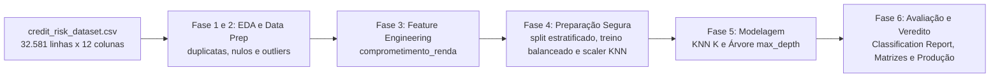

# Análise e Predição de Risco de Crédito | `loan_status`

**Projeto avaliativo — Machine Learning e Visão Computacional [T5] | Módulo 1**

Pipeline preditivo de ponta a ponta para análise exploratória, limpeza estatística, engenharia de atributos, controle de *overfitting* e avaliação de risco de crédito com **Python**, **pandas**, **scikit-learn** e **Jupyter Notebook**[cite: 2, 4, 5, 11].

> **Fonte dos dados:** Base de risco de crédito (`credit_risk_dataset.csv`) fornecida na **Opção A (Risco de Crédito — Setor Financeiro)** do projeto avaliativo, contendo **32.581 registros** e **12 colunas** originais[cite: 2, 11].

## 🔗 Entrega e artefatos do projeto

| Recurso | Localização / Status |
|---|---|
| 🎥 Vídeo de apresentação | Gravação de até 7 minutos (modo leitor público no Google Drive / YouTube) |
| 💻 Repositório GitHub | https://github.com/fgofilipe/analise-risco-credito |
| 📊 Base de dados | dados/credit_risk_dataset.csv |

## 1. Contexto e problema de negócio

Em operações de crédito, treinar algoritmos preditivos sobre dados brutos, duplicados, com valores ausentes mal tratados ou sem controle de complexidade gera modelos instáveis e decisões financeiras imprecisas (*Garbage In, Garbage Out*)[cite: 2]. O objetivo deste projeto é construir um pipeline estruturado para prever se um cliente se tornará inadimplente (`loan_status = 1`) ou pagará o empréstimo em dia (`loan_status = 0`)[cite: 2].

Sob a ótica do negócio bancário, os dois tipos de erro produzem impactos financeiros distintos[cite: 2]:
* **Falso Negativo (FN):** classificar um mau pagador (`loan_status = 1`) como seguro (`loan_status = 0`), concedendo crédito com maior risco de perda direta do principal e dos juros não recebidos[cite: 2].
* **Falso Positivo (FP):** classificar um bom pagador (`loan_status = 0`) como risco de calote (`loan_status = 1`), recusando ou restringindo crédito a um cliente saudável e gerando custo de oportunidade e perda de receita/relacionamento[cite: 2].

## 2. Tecnologias e arquitetura do pipeline

| Camada | Tecnologia | Finalidade |
|---|---|---|
| Origem | `dados/credit_risk_dataset.csv` | Base histórica de tomadores de crédito e status de pagamento[cite: 2, 11, 12] |
| Manipulação e limpeza | Python + `pandas` + `numpy` | EDA, remoção de duplicatas, imputação pela mediana, filtros e `comprometimento_renda`[cite: 4, 11] |
| Visualização | `matplotlib` + `seaborn` | Histograma, distribuição do alvo, correlação de Pearson, *boxplots*, curvas de *overfitting* e matrizes de confusão[cite: 4, 5, 11] |
| Modelagem e avaliação | `scikit-learn` | `train_test_split` estratificado, `StandardScaler`, `KNeighborsClassifier`, `DecisionTreeClassifier` e métricas[cite: 5, 17] |
| Versionamento | Git + GitHub | *Branches* por etapa, *commits* semânticos e publicação na `main`[cite: 6, 8, 21] |



### Dicionário de dados (atualizado)

Além das **12 colunas** originais, o pipeline adiciona a variável calculada `comprometimento_renda` na Fase 3[cite: 4, 11]:

| Variável | Tipo | Descrição |
|---|---|---|
| `person_age` | Inteiro (`int64`) | Idade do solicitante em anos[cite: 11]. |
| `person_income` | Inteiro (`int64`) | Renda anual declarada do solicitante[cite: 11]. |
| `person_home_ownership` | Texto (`object` / `str`) | Situação de moradia (`RENT`, `MORTGAGE`, `OWN`, `OTHER`)[cite: 11]. |
| `person_emp_length` | Decimal (`float64`) | Tempo de emprego em anos (continha **895** valores nulos na base bruta)[cite: 11]. |
| `loan_intent` | Texto (`object` / `str`) | Finalidade do empréstimo (`EDUCATION`, `MEDICAL`, `VENTURE`, `PERSONAL`, `DEBTCONSOLIDATION`, `HOMEIMPROVEMENT`)[cite: 11]. |
| `loan_grade` | Texto (`object` / `str`) | Faixa/classificação de risco do empréstimo (`A` a `G`)[cite: 11]. |
| `loan_amnt` | Inteiro (`int64`) | Valor total solicitado no empréstimo[cite: 11]. |
| `loan_int_rate` | Decimal (`float64`) | Taxa de juros do empréstimo (continha **3.116** valores nulos na base bruta)[cite: 11]. |
| `loan_status` | Inteiro (`int64`) | **Variável alvo:** `0` = adimplente / pagamento em dia; `1` = inadimplente[cite: 2, 11]. |
| `loan_percent_income` | Decimal (`float64`) | Percentual do empréstimo em relação à renda presente na base original[cite: 11]. |
| `cb_person_default_on_file` | Texto (`object` / `str`) | Histórico prévio de inadimplência (`Y` = sim, `N` = não)[cite: 11]. |
| `cb_person_cred_hist_length` | Inteiro (`int64`) | Tempo de histórico de crédito do cliente em anos[cite: 11]. |
| `comprometimento_renda` | Decimal (`float64`) | **Coluna calculada (Fase 3):** `(loan_amnt / person_income) * 100`, indicando o percentual da renda anual comprometido pelo empréstimo[cite: 4]. |

## 3. Tratamento e regras de negócio

O pipeline segue regras explícitas e justificadas ao longo das seis fases[cite: 3, 4, 5]:

| Etapa / situação | Decisão técnica adotada | Justificativa principal |
|---|---|---|
| Linhas duplicadas | Remoção de **165** registros duplicados (`32.581` -> `32.416`)[cite: 4, 11] | Evita redundância e viés de contagem durante o treino[cite: 4]. |
| Valores nulos (`person_emp_length` e `loan_int_rate`) | Imputação pela **mediana** após remoção de duplicatas[cite: 4] | A mediana é resistente a assimetrias e valores extremos na distribuição[cite: 4]. |
| *Outliers* e inconsistências | Remoção de **7** linhas com inconsistências lógicas evidentes (`32.409` linhas restantes)[cite: 4] | **KNN** é sensível a distâncias e *outliers*; **Árvore de Decisão** é robusta a *outliers* e cortes monotônicos[cite: 4, 5]. |
| Feature Engineering | Criação de `comprometimento_renda = (loan_amnt / person_income) * 100` após tratar nulos[cite: 4] | Evita `NaN` ou infinitos e mede o peso do empréstimo sobre a renda[cite: 4]. |
| Divisão e balanceamento | `train_test_split` (`test_size=0.20`, `stratify=y`) e balanceamento **apenas no treino**[cite: 4, 5] | Preserva a proporção das classes e impede *data leakage* no conjunto de teste[cite: 4, 5, 8]. |
| Escalonamento seguro | `StandardScaler` (`fit_transform` no treino, `transform` no teste) **apenas nas variáveis contínuas do KNN**[cite: 5, 8] | O KNN depende de distâncias entre variáveis; a Árvore dispensa escalonamento por realizar cortes monotônicos independentes de escala[cite: 5, 8]. |

## 4. Resultados e resumo executivo para a diretoria

Na análise exploratória, a variável alvo `loan_status` apresentou **78,18%** de adimplentes (`0`) e **21,82%** de inadimplentes (`1`), enquanto `comprometimento_renda` mostrou média de **24,87%** entre inadimplentes frente a **14,87%** entre adimplentes.

Na validação de complexidade (Fase 5), modelos com alta flexibilidade sobre os dados de treino — como `K=1` no KNN ou `max_depth=None` na Árvore de Decisão — apresentaram ajuste excessivo ao treino com perda de generalização no teste (*overfitting*)[cite: 5, 19]. Na comparação entre os melhores modelos avaliados na Fase 6 (`KNN` com `K=9` vs. `Árvore de Decisão` com `max_depth=10`)[cite: 5, 19]:

| Indicador / métrica | KNN (`n_neighbors=9`) | Árvore de Decisão (`max_depth=10`) |
|---|---|---:|
| Escalonamento de variáveis contínuas | Aplicado (`StandardScaler`)[cite: 5] | Não aplicado (cortes monotônicos)[cite: 5] |
| Acurácia no teste | 0,8082 | **0,9139** |
| *F1-Score* no teste (classe `1` — inadimplente) | 0,6390 | **0,7944** |
| *Recall* no teste (classe `1` — inadimplente) | **0,7757** | 0,7602 |
| Falsos Positivos (FP — bom pagador recusado) | 925 | **218** |
| Falsos Negativos (FN — mau pagador aprovado) | **318** | 340 |

**Resumo executivo e veredito:** Embora o `KNN (K=9)` obtenha *Recall* levemente superior para a classe `1` (`0,7757` vs. `0,7602`), ele gera **925 Falsos Positivos** contra apenas **218** da **Árvore de Decisão (`max_depth=10`)**, além de apresentar acurácia geral e *F1-Score* bem menores no teste. Para a operação do banco, a **Árvore de Decisão (`max_depth=10`)** é a recomendação para produção: entrega maior desempenho global e maior *F1-Score* na classe de risco, reduz drasticamente a recusa indevida de bons clientes, dispensa escalonamento e oferece regras interpretáveis para auditoria e governança.

## 5. Estrutura do repositório

```text
analise-risco-credito/
├── .venv/                      # Ambiente virtual Python (ignorado via .gitignore)
├── dados/
│   └── credit_risk_dataset.csv # Base de dados de risco de crédito
├── .gitignore                  # Regras de exclusão do Git
├── README.md                   # Documentação técnica e resumo executivo
└── analise_risco_credito.ipynb # Notebook completo com as Fases 1 a 6
```

## 6. Como executar o projeto

### Pré-requisitos

* Python 3.13+ com `pandas`, `numpy`, `matplotlib`, `seaborn` e `scikit-learn` (e opcionalmente `imbalanced-learn`)[cite: 5, 11, 17].
* Arquivo `dados/credit_risk_dataset.csv` disponível na pasta `dados/`[cite: 11, 12].

### Passo a passo

1. Crie e ative o ambiente virtual na raiz do projeto[cite: 12]:

```bash
python -m venv .venv
.venv\Scripts\Activate
```

2. Instale as bibliotecas necessárias:

```bash
pip install pandas numpy matplotlib seaborn scikit-learn imbalanced-learn
```

3. Abra o arquivo `analise_risco_credito.ipynb` no VS Code ou Jupyter, selecione o kernel do `.venv` e execute as células sequencialmente da Fase 1 à Fase 6[cite: 4, 5, 11, 12].

## 7. Decisões técnicas e limitações

**Decisões principais**
* **Imputação pela mediana e filtro de inconsistências lógicas:** protege o pipeline contra valores extremos na renda, idade e tempo de emprego[cite: 4].
* **Balanceamento restrito ao treino e escalonamento apenas no KNN:** evita vazamento de dados e respeita as propriedades matemáticas de cada algoritmo[cite: 4, 5, 8].
* **Comparação de curvas treino vs. teste:** fundamenta a escolha de `K` e `max_depth` com base na capacidade de generalização, não apenas no desempenho no treino[cite: 5, 8, 9].

**Limitações e cuidados**
* Os resultados dependem da qualidade, completude e representatividade histórica da base `credit_risk_dataset.csv`[cite: 2, 11].
* A análise avalia padrões estatísticos da base fornecida e não substitui políticas de crédito, análise de cenários macroeconômicos ou limites de risco da instituição financeira[cite: 2].
* A escolha final entre reduzir ainda mais Falsos Negativos ou Falsos Positivos em produção pode ser calibrada por limiar de decisão/custo financeiro definido pela diretoria[cite: 2, 5].

## 8. Autoria e entrega

**Desenvolvimento:** Filipe de Oliveira Gomes 

**Atividade:** Machine Learning e Visão Computacional [T5] — Situação de Aprendizagem (Projeto Avaliativo), Módulo 3

**Entrega:** Repositório GitHub público na branch `main` contendo `analise_risco_credito.ipynb` e `README.md`, acompanhado do link do vídeo de apresentação de até 7 minutos conforme as regras do AVA